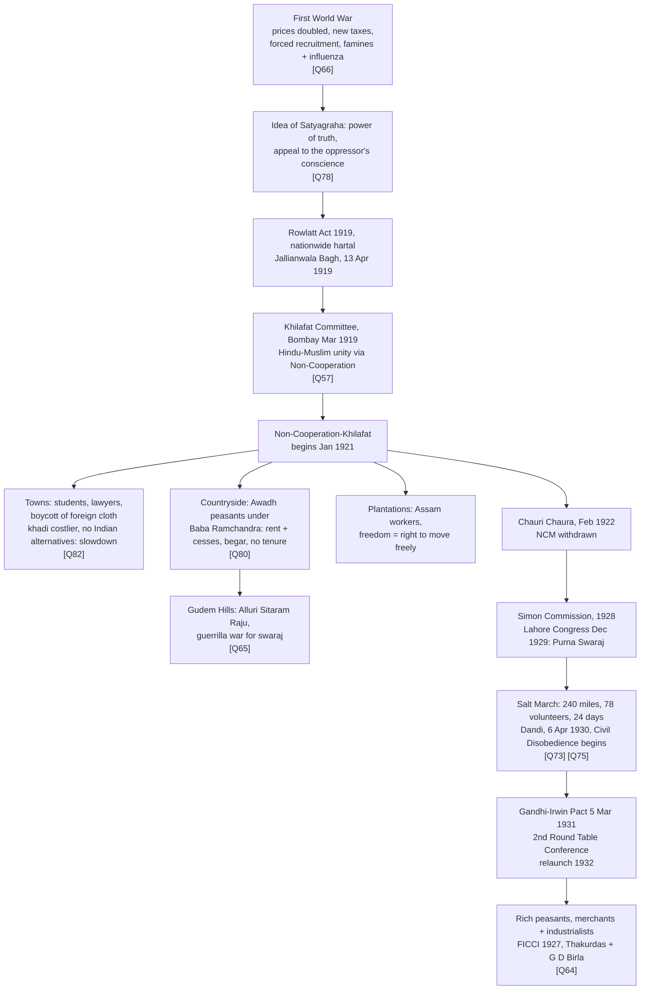

---
tags:
  - sst
  - class10
  - history
  - nationalism
  - homework
---

# 🇮🇳 Nationalism in India - SST Homework

> [!info]
> **Class X CBSE** | Chapter II, *India and the Contemporary World II* (NCERT official reprint 2026-27, book pp. 29-50)
> **Workbook:** EduCart Social Science Class X
> **Answers:** written pointwise from the NCERT text only
> **Chapter PDF:** `00-Inbox\Nationalism in India\NCERT-jess302-Nationalism-in-India.pdf`
> **Extracted text:** `00-Inbox\Nationalism in India\nationalism-in-india-text.txt`

## Quick Navigation

| Q | Topic | Marks | NCERT page |
|---|-------|:-----:|:----------:|
| 57 | Khilafat Movement reasons | 2 | 32 |
| 64 | Merchants + industrialists and CDM | 3 | 42 |
| 65 | Tribal peasants and Swaraj | 3 | 36-37 |
| 66 | First World War's effect on India | 3 | 30 |
| 73 | Salt as a uniting symbol | 3 | 39 |
| 75 | Salt March as tool of resistance | 3 | 39-40 |
| 78 | Satyagraha + Gandhiji's contribution | 3 | 30-31 |
| 80 | Problems of Awadh peasants | 3 | 35 |
| 82 | Why NCM slowed in cities | 3 | 34 |

---

## Chapter at a Glance

---

## Q57 - What were the reasons for starting the Khilafat Movement?

*2 marks [Delhi Gov. QB 2024] | NCERT p. 32*

> [!success] Exam-ready answer
> 1. The First World War ended with the defeat of Ottoman Turkey, and there were rumours of a harsh peace treaty on the Ottoman emperor, the Khalifa, the spiritual head of the Islamic world.
> 2. The Khilafat issue became an opportunity to defend the Khalifa's temporal powers and to bring Hindus and Muslims together under one united mass movement.

> [!note]- Detailed version
> The First World War ended with the defeat of Ottoman Turkey. There were rumours that a harsh peace treaty was going to be imposed on the Ottoman emperor, who was the spiritual head of the Islamic world (the Khalifa). To defend the Khalifa's temporal powers, a Khilafat Committee was formed in Bombay in March 1919. A young generation of Muslim leaders like the brothers Muhammad Ali and Shaukat Ali began discussing with Mahatma Gandhi the possibility of a united mass action. Gandhiji saw this as an opportunity to bring Muslims under the umbrella of a unified national movement. At the Calcutta session of the Congress in September 1920, he convinced other leaders of the need to start a non-cooperation movement in support of Khilafat as well as for swaraj.

Why did the Khilafat Movement start in India (two reasons)?::WWI ended with Ottoman Turkey defeated and a rumoured harsh treaty on the Khalifa, so Muslims wanted to defend the Khalifa's powers; Gandhiji used the issue to bring Hindus and Muslims together in one united mass action (Khilafat Committee, Bombay, March 1919) #card

---

## Q64 - How did the Indian merchants and industrialists relate themselves to the Civil Disobedience Movement?

*3 marks [CBSE SQP 2022] | NCERT p. 42*

> [!success] Exam-ready answer
> 1. Having made huge profits during the First World War, they reacted against colonial policies that restricted business activity, demanding protection against imports and a favourable rupee-sterling foreign exchange ratio.
> 2. They organised through the Indian Industrial and Commercial Congress (1920) and FICCI (1927), led by Purshottamdas Thakurdas and G. D. Birla, funding the movement and refusing to buy or sell imported goods.
> 3. They saw swaraj as the time when colonial restrictions on business would no longer exist and trade would flourish without constraints.

> [!note]- Detailed version
> During the First World War, Indian merchants and industrialists had made huge profits and become powerful. Keen on expanding their business, they now reacted against colonial policies that restricted business activities. They wanted protection against imports of foreign goods, and a rupee-sterling foreign exchange ratio that would discourage imports. To organise business interests, they formed the Indian Industrial and Commercial Congress in 1920 and the Federation of the Indian Chamber of Commerce and Industries (FICCI) in 1927. Led by prominent industrialists like Purshottamdas Thakurdas and G. D. Birla, the industrialists attacked colonial control over the Indian economy, and supported the Civil Disobedience Movement when it was first launched. They gave financial assistance and refused to buy or sell imported goods. Most businessmen came to see swaraj as a time when colonial restrictions on business would no longer exist and trade and industry would flourish without constraints. But after the failure of the Round Table Conference, business groups were no longer uniformly enthusiastic: they were apprehensive of militant activities, prolonged disruption of business, and the growing influence of socialism.

How did merchants and industrialists relate themselves to the Civil Disobedience Movement?::WWI profits made them powerful, they wanted protection from imports and a favourable rupee-sterling ratio; they organised through the 1920 Indian Industrial and Commercial Congress and FICCI 1927, backing the movement with money and import boycotts under Thakurdas and Birla; they saw swaraj as business expanding without colonial restrictions #card

---

## Q65 - How did the tribal peasants interpret the message of Mahatma Gandhi and the idea of 'Swaraj'?

*3 marks [CBSE SQP 2022] | NCERT pp. 36-37*

> [!success] Exam-ready answer
> 1. They interpreted swaraj as liberation through force: a militant guerrilla movement spread in the Gudem Hills of Andhra Pradesh in the early 1920s.
> 2. The colonial government had closed large forests, denying them grazing, fuelwood and fruits, and forced begar for road building, so with livelihoods hit and traditional rights denied, the hill people revolted.
> 3. Led by Alluri Sitaram Raju, they praised Gandhiji and the Non-Cooperation Movement yet insisted India could be liberated only by use of force, attacking police stations and carrying on guerrilla warfare for swaraj.

> [!note]- Detailed version
> Tribal peasants interpreted the message of Mahatma Gandhi and the idea of swaraj in yet another way. In the Gudem Hills of Andhra Pradesh, a militant guerrilla movement spread in the early 1920s, not a form of struggle that the Congress could approve. As in other forest regions, the colonial government had closed large forest areas, preventing people from entering to graze their cattle, or to collect fuelwood and fruits. Not only were their livelihoods affected, they felt their traditional rights were being denied. When the government began forcing them to contribute begar for road building, the hill people revolted. Alluri Sitaram Raju claimed special powers, talked of the greatness of Mahatma Gandhi, said he was inspired by the Non-Cooperation Movement, and persuaded people to wear khadi and give up drinking. But at the same time he asserted that India could be liberated only by the use of force, not non-violence. The Gudem rebels attacked police stations, attempted to kill British officials and carried on guerrilla warfare for achieving swaraj. Raju was captured and executed in 1924 and became a folk hero. When tribals raised slogans like 'Swatantra Bharat' they were emotionally relating to an all-India agitation.

How did tribal peasants interpret Gandhi's message and swaraj?::They read swaraj as liberation through force, running a militant guerrilla struggle in the Gudem Hills against closed forests and forced begar under Alluri Sitaram Raju; though Raju praised Gandhiji, khadi and NCM, he held India could only be freed by force, attacking police stations until his execution in 1924 #card

---

## Q66 - How was the social and political situation of India affected by the First World War?

*3 marks [CBSE SQP 2022]. The OR version (implication of the FWW on the economic and political situation) takes the same points | NCERT p. 30*

> [!success] Exam-ready answer
> 1. The war created a new economic and political situation: defence expenditure rose hugely, financed by war loans and increasing taxes, with customs duties raised and income tax introduced.
> 2. Prices doubled between 1913 and 1918, causing extreme hardship, and forced recruitment of soldiers in rural areas caused widespread anger.
> 3. Crop failures in 1918-19 and 1920-21, plus the influenza epidemic, killed 12 to 13 million people (1921 census), and the hardships did not end after the war.

> [!note]- Detailed version
> First of all, the war created a new economic and political situation. It led to a huge increase in defence expenditure which was financed by war loans and increasing taxes: customs duties were raised and income tax introduced. Through the war years prices increased, doubling between 1913 and 1918, leading to extreme hardship for the common people. Villages were called upon to supply soldiers, and the forced recruitment in rural areas caused widespread anger. Then in 1918-19 and 1920-21, crops failed in many parts of India, resulting in acute shortages of food. This was accompanied by an influenza epidemic. According to the census of 1921, 12 to 13 million people perished as a result of famines and the epidemic. People hoped that their hardships would end after the war was over, but that did not happen.

How was India's social and political situation affected by the First World War?::New economic and political situation from higher defence spending financed by war loans and taxes (customs duties raised, income tax introduced); prices doubled 1913-18 with forced recruitment causing anger; crop failures 1918-21 plus influenza killed 12-13 million and hardships continued after the war #card

---

## Q73 - Why did Mahatma Gandhi find salt to be a powerful symbol that could unite the nation?

*3 marks [CBSE 2018]. The OR justification version takes the same points | NCERT p. 39*

> [!success] Exam-ready answer
> 1. Salt was consumed by the rich and the poor alike, one of the most essential items of food, so every class of society could identify with the struggle.
> 2. The salt tax and the government monopoly over its production revealed the most oppressive face of British rule.
> 3. Abolishing that tax was the most stirring of the eleven demands sent to Viceroy Irwin on 31 January 1930, and violating the salt law at Dandi on 6 April 1930 related freedom to the everyday life of all Indians.

> [!note]- Detailed version
> Mahatma Gandhi found in salt a powerful symbol that could unite the nation. On 31 January 1930, he sent a letter to Viceroy Irwin stating eleven demands. Some were of general interest; others were specific demands of different classes, from industrialists to peasants. The idea was to make the demands wide-ranging, so that all classes within Indian society could identify with them and everyone could be brought together in a united campaign. The most stirring of all was the demand to abolish the salt tax. Salt was something consumed by the rich and the poor alike, and it was one of the most essential items of food. The tax on salt and the government monopoly over its production, Mahatma Gandhi declared, revealed the most oppressive face of British rule. When the salt law was ceremonially violated at Dandi on 6 April 1930, the abstract idea of freedom was related to concrete issues of everyday life.

Why did Gandhiji find salt to be a powerful uniting symbol?::Rich and poor alike consumed salt, an essential food item, so all classes of Indians could rally around it; the salt tax and government monopoly showed British rule at its most oppressive, and abolishing the salt tax was the most stirring of the eleven demands of 31 Jan 1930 #card

---

## Q75 - Why did the Salt March become an effective tool of resistance against colonialism?

*3 marks [CBSE QB 2023]. The OR version (Irwin's step that enraged Gandhiji) takes the same points | NCERT pp. 39-40*

> [!success] Exam-ready answer
> 1. The letter of 31 January 1930 with eleven demands was an ultimatum, and Irwin was unwilling to negotiate, so the march itself became the resistance.
> 2. The 240 mile march from Sabarmati to Dandi, with 78 trusted volunteers walking 24 days at about 10 miles a day, brought thousands to hear the call for peaceful defiance; on 6 April 1930 the salt law was violated by manufacturing salt from sea water, marking the beginning of the Civil Disobedience Movement.
> 3. Thousands then broke the salt law, manufactured salt and demonstrated before government salt factories; foreign cloth was boycotted, liquor shops picketed, and peasants refused revenue and chaukidari taxes.

> [!note]- Detailed version
> Mahatma Gandhi's letter to Viceroy Irwin on 31 January 1930 was, in a way, an ultimatum: if the demands were not fulfilled by 11 March, the Congress would launch a civil disobedience campaign. Irwin was unwilling to negotiate. So Mahatma Gandhi started his famous salt march accompanied by 78 of his trusted volunteers. The march was over 240 miles, from Gandhiji's ashram in Sabarmati to the Gujarati coastal town of Dandi. The volunteers walked for 24 days, about 10 miles a day. Thousands came to hear Mahatma Gandhi wherever he stopped, and he told them what he meant by swaraj and urged them to peacefully defy the British. On 6 April he reached Dandi, and ceremonially violated the law, manufacturing salt by boiling sea water. This marked the beginning of the Civil Disobedience Movement. Thousands in different parts of the country broke the salt law, manufactured salt and demonstrated in front of government salt factories. As the movement spread, foreign cloth was boycotted and liquor shops were picketed. Peasants refused to pay revenue and chaukidari taxes, village officials resigned, and in many places forest people violated forest laws.

Why was the Salt March an effective tool of resistance?::Irwin refusing the eleven demands triggered it, and a 240 mile, 24 day walk with 78 volunteers let thousands hear Gandhiji's message of peaceful defiance; breaking the salt law at Dandi on 6 Apr 1930 launched mass civil disobedience, with salt breaking, cloth boycotts and tax refusal spreading across India #card

---

## Q78 - Write Gandhiji's contribution towards nationalism in India with reference to Satyagraha (any three points)

*3 marks [CBSE Marking Scheme 2025] | NCERT pp. 30-31*

> [!success] Exam-ready answer
> 1. The idea of satyagraha emphasised the power of truth and the need to search for truth: without violence or vengeance, a satyagrahi persuades the oppressor by appealing to his conscience, a dharma Gandhiji believed could unite all Indians.
> 2. Champaran, 1917: inspired the peasants of Bihar to struggle against the oppressive plantation system.
> 3. Kheda, 1918: supported the peasants hit by crop failure and a plague epidemic in demanding relaxation of revenue collection. *(Ahmedabad, 1918, cotton mill workers, can replace any one of the two movements.)*

> [!note]- Detailed version
> Mahatma Gandhi returned to India in January 1915 from South Africa, where he had successfully fought the racist regime with a novel method of mass agitation which he called satyagraha. The idea of satyagraha emphasised the power of truth and the need to search for truth. It suggested that if the cause was true, if the struggle was against injustice, then physical force was not necessary to fight the oppressor. Without seeking vengeance or being aggressive, a satyagrahi could win the battle through non-violence, by appealing to the conscience of the oppressor. People, including the oppressors, had to be persuaded to see the truth instead of being forced to accept it through violence. By this struggle, truth was bound to ultimately triumph. Mahatma Gandhi believed that this dharma of non-violence could unite all Indians. After arriving in India, he successfully organised satyagraha at Champaran in 1917 (against the oppressive plantation system), at Ahmedabad in 1918 (amongst cotton mill workers), and at Kheda in 1918 (supporting peasants hit by crop failure and a plague epidemic, who could not pay revenue and demanded its collection be relaxed).

What is satyagraha and where did Gandhiji apply it in India?::Emphasis on the power of truth, winning by appealing to the oppressor's conscience rather than violence, a dharma Gandhiji believed could unite all Indians; applied in Champaran 1917 against the plantation system, Kheda 1918 for peasants hit by crop failure and plague, and Ahmedabad 1918 among cotton mill workers #card

---

## Q80 - Peasants of Awadh were working as serfs in the fields of landlords. Identify three other problems faced by them.

*3 marks | NCERT p. 35*

> [!success] Exam-ready answer
> 1. Talukdars and landlords demanded exorbitantly high rents and a variety of other cesses.
> 2. Peasants had to do begar and work at landlords' farms without any payment.
> 3. As tenants they had no security of tenure, being regularly evicted so that they could acquire no right over the leased land.

> [!note]- Detailed version
> In Awadh, peasants were led by Baba Ramchandra, a sanyasi who had earlier been to Fiji as an indentured labourer. The movement here was against talukdars and landlords who demanded from peasants exorbitantly high rents and a variety of other cesses. Peasants had to do begar and work at landlords' farms without any payment. As tenants they had no security of tenure, being regularly evicted so that they could acquire no right over the leased land. The peasant movement demanded reduction of revenue, abolition of begar, and social boycott of oppressive landlords. In many places nai-dhobi bandhs were organised by panchayats to deprive landlords of the services of even barbers and washermen.

What problems did Awadh peasants face besides serfdom?::Exorbitantly high rents and a variety of other cesses from talukdars and landlords; forced begar, working landlords' farms without payment; no security of tenure and regular eviction giving no right over leased land #card

---

## Q82 - Why did the Non-Cooperation Movement gradually slow down in the cities?

*3 marks [CBSE 2019] | NCERT p. 34*

> [!success] Exam-ready answer
> 1. Khadi cloth was often more expensive than mass produced mill cloth, and poor people could not afford it, so the boycott of mill cloth could not last long.
> 2. Alternative Indian institutions, to be used in place of the boycotted British ones, were slow to come up.
> 3. So students and teachers began trickling back to government schools, and lawyers joined back work in government courts.

> [!note]- Detailed version
> The Non-Cooperation Movement in the cities gradually slowed down for a variety of reasons. Khadi cloth was often more expensive than mass-produced mill cloth, and poor people could not afford to buy it. How then could they boycott mill cloth for too long? Similarly, the boycott of British institutions posed a problem. For the movement to be successful, alternative Indian institutions had to be set up so that they could be used in place of the British ones. These were slow to come up. So students and teachers began trickling back to government schools, and lawyers joined back work in government courts.

Why did Non-Cooperation slow down in the cities?::Khadi was costlier than mill cloth so poor people could not sustain the boycott; alternative Indian institutions to replace British ones were slow to come up; students, teachers and lawyers trickled back to government schools and courts #card

---

## Quick Recall Dates

> [!example] Some important dates (NCERT p. 42)
> - **1918-19:** distressed UP peasants organised by Baba Ramchandra
> - **April 1919:** Gandhian hartal against Rowlatt Act, Jallianwala Bagh massacre
> - **January 1921:** Non-Cooperation and Khilafat movement launched
> - **February 1922:** Chauri Chaura, Gandhiji withdraws Non-Cooperation movement
> - **May 1924:** Alluri Sitarama Raju arrested, ending a two-year armed tribal struggle
> - **December 1929:** Lahore Congress, Congress adopts the demand for 'Purna Swaraj'
> - **1930:** Ambedkar establishes Depressed Classes Association
> - **March 1930:** Gandhiji begins Civil Disobedience Movement by breaking salt law at Dandi
> - **March 1931:** Gandhiji ends Civil Disobedience Movement
> - **December 1931:** Second Round Table Conference
> - **1932:** Civil Disobedience re-launched

Some important dates (NCERT p. 42)::1918-19 Baba Ramchandra organises UP peasants; Apr 1919 Rowlatt hartal + Jallianwala Bagh; Jan 1921 NCM-Khilafat launched; Feb 1922 Chauri Chaura, NCM withdrawn; May 1924 Raju arrested; Dec 1929 Lahore Congress, Purna Swaraj; 1930 Ambedkar's Depressed Classes Assn; Mar 1930 salt law broken at Dandi; Mar 1931 Gandhi-Irwin Pact; Dec 1931 Second Round Table Conference; 1932 CDM relaunched #card

---

## OR-Pair Framing Trick

Q66, Q73 and Q75 each carry an OR pair in the workbook, but both phrasings answer to the same three points:

- **Q66:** open with "The war created a new economic and political situation..." (works for both)
- **Q73:** open with "Mahatma Gandhi found in salt a powerful symbol that could unite the nation because..."
- **Q75:** open with "The Salt March became an effective tool of resistance because...", or, for the OR version, start from Irwin's refusal to negotiate the eleven demands.

## Source Files

All source files now live in this folder (`00-Inbox\Nationalism in India\`) alongside this note:

- NCERT PDF: `NCERT-jess302-Nationalism-in-India.pdf`
- Extracted text: `nationalism-in-india-text.txt`
- Question photos: `IMG_20261027_212742930.webp` and the rest of the `IMG_20261027_*` set
