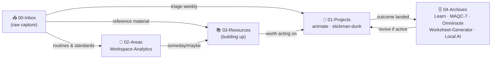

# 🏠 HOME — Vault Dashboard

One note to route everything. PARA layout: capture in **Inbox**, act in **Projects**, maintain in **Areas**, look up in **Resources**, forget in **Archives**.

## 🗺️ PARA Flow

## 🚀 01-Projects — Active

| Project | Where | Key doc |
| --- | --- | --- |
| **animate workspace** (animation framework) | `01-Projects/projects/animate` | [[01-Projects/projects/animate/README\|README]] |
| **stickman-dunk** (5s crosshatch ink dunk) | `pieces/stickman-dunk` | [[01-Projects/projects/animate/pieces/stickman-dunk/plan.md\|plan.md]] |

Project log & task notes: [[01-Projects/OpenCode-Tasks|OpenCode-Tasks]]

## 🧭 02-Areas — Ongoing

| Area | Holds |
| --- | --- |
| [[02-Areas/Workspace-Analytics|Workspace-Analytics]] | workspace analytics workstream |
| [[02-Areas/README|README]] | area definitions & guidelines |

## 📚 03-Resources

Empty for now ([[03-Resources/README|README]] defines the structure). Reference material and study notes land here.

## 🗄️ 04-Archives — Completed

| Hub | What it holds | Entry |
| --- | --- | --- |
| Learn | AI learning system project | [[04-Archives/Learn/README\|README]] |
| MAQC-7 | tournament tracking project | [[04-Archives/MAQC-7/README\|README]] |
| Worksheet-Generator | worksheet tooling project | [[04-Archives/Worksheet-Generator/README\|README]] |
| Omniroute | retired launcher (daily use moved to OpenCode) | [[04-Archives/Omniroute/README\|README]] |
| Local AI (barebones) | llama.cpp Qwen3.5-9B server, CPU build | revive: double-click `start.bat` · [[04-Archives/Local AI (barebones)/Docs/LOCAL_AI_STARTUP.md\|LOCAL_AI_STARTUP]] |

## 📌 Root Docs

| Doc | Use |
| --- | --- |
| [[AGENTS]] | vault rules, hard rules, environment facts |
| [[DESIGN.md|DESIGN]] | Stitch design-system spec for this vault |

## ✅ Housekeeping

- [ ] Capture anything new in `00-Inbox` first; triage into PARA folders weekly
- [ ] Completed projects move from `01-Projects` to `04-Archives` promptly
- [ ] Keep the vault as a vault; don't commit `thumbnails\` or `.obsidian\` state

---
*Last Updated: 2026-10-18*
