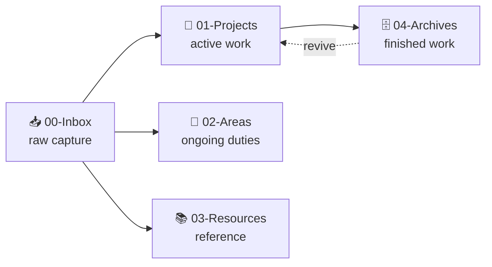

# Vault Brief

The vault is an **Obsidian second brain** run as a PARA structure, with an AI agent (OpenCode) wired into it. Notes are plain markdown, versioned in git, and reachable from [[HOME]].

## PARA Flow

Capture in `00-Inbox`, triage weekly into a project, area, or resource. Move finished projects to `04-Archives`.

## What's Live Now

| Location | What it is | State |
| --- | --- | --- |
| `01-Projects/projects/animate` | Animation framework: grammar, styles, piece templates, Remotion knowledge base | Active |
| `.../pieces/stickman-dunk` | 5s crosshatch ink basketball dunk animation | In progress |
| `02-Areas/Workspace-Analytics` | Ongoing analytics workstream | Maintained |
| `03-Resources` | Reference material and study notes | Empty scaffold |

## What's Archived

| Hub                      | What it holds                                                                    |
| ------------------------ | -------------------------------------------------------------------------------- |
| **Learn**                | AI learning system project: lessons, pedagogy docs, agent and skill sources      |
| **MAQC-7**               | Tournament tracking across 6 weeks: weekly briefs, mod questions, knowledge base |
| **Worksheet-Generator**  | Worksheet tooling and templates                                                  |
| **Omniroute**            | Retired launcher, daily use moved to OpenCode                                    |
| **Local AI (barebones)** | llama.cpp Qwen3.5-9B CPU server, revive with `start.bat`                         |
| **Stickman-Basketball**  | Finished stickman basketball cuts: videos, audio, SFX pipeline, dev piece        |
| **OpenCode-Migration**   | Skill-migration scripts and vcpkg build logs from the temp workspace              |
| **Multiroom Audio (Snapcast)** | Home multi-room audio: snapserver/MPD setup, configs, on-demand scripts    |

## Reading Order

1. [[HOME]]: dashboard that routes to everything
2. [[AGENTS]]: vault rules, hard rules, environment facts
3. [[DESIGN]]: Stitch design-system spec for the vault
4. [[01-Projects/OpenCode-Tasks]]: project log and task notes

## Known Drift

`01-Projects/README.md` still claims "no active projects" even though the `animate` workspace lives there. `HOME.md` is the accurate index; the folder README needs updating.

---

*Created: 2026-10-24*
